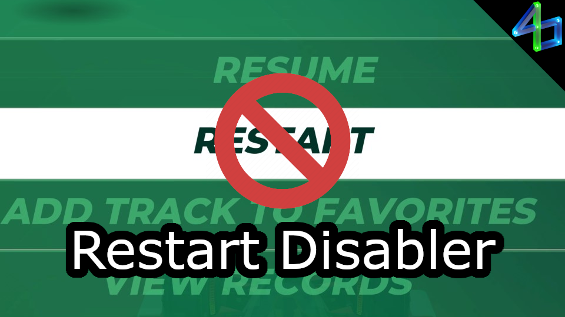

# Restart Disabler

Prevents the "Restart" button in the pause menu from being clickable.

- Mostly useful for RPG/trial maps.
- Must be manually toggled from the menu each time you load a map.
- Does not prevent selecting the button with a keyboard or pad, only the mouse.
- Does not work in the editor.

